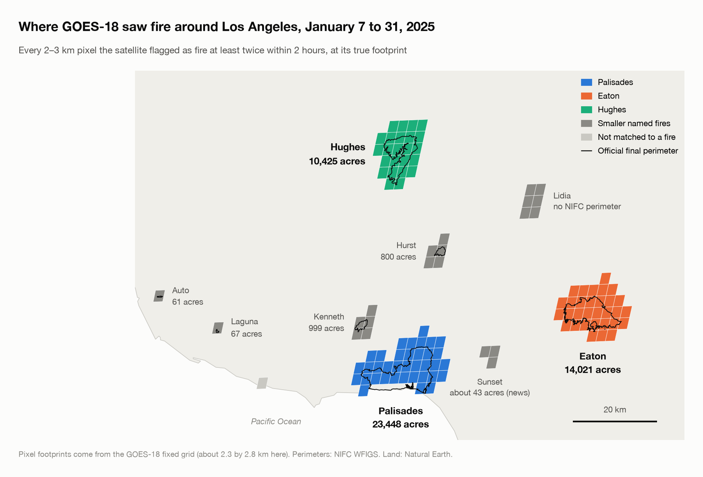
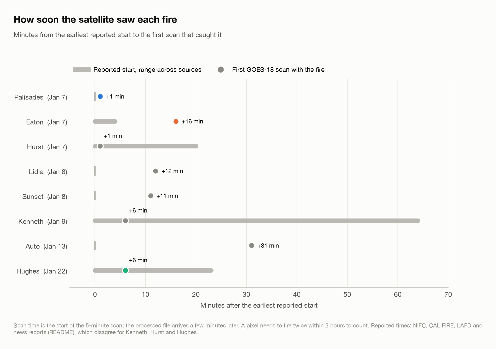
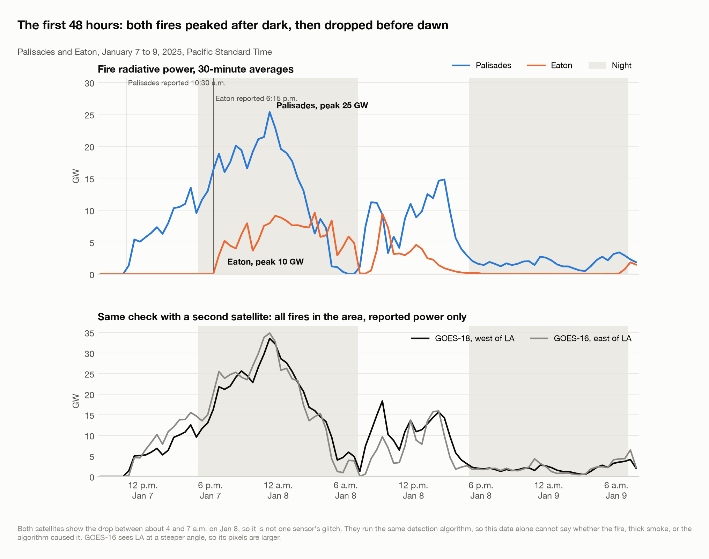
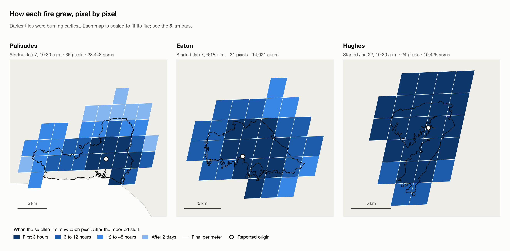
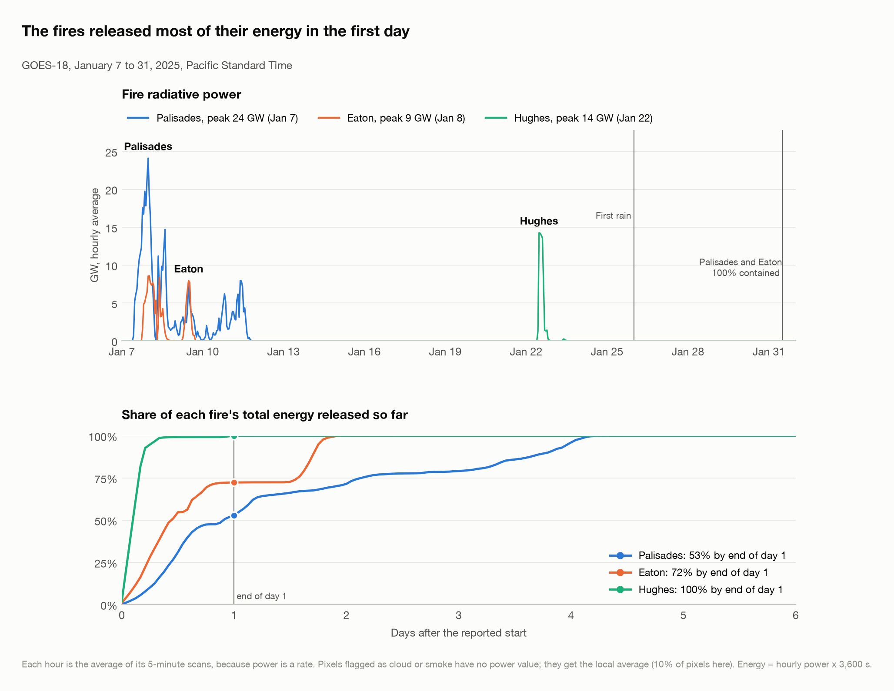
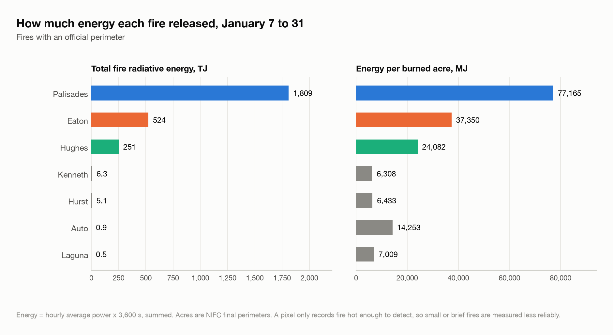

# Fire After Dark: The January 2025 Los Angeles Fires, Seen From Space

**DSC 106 Final Project Proposal**
**Team:** Steven Ngo, _(add teammates)_

## Summary

We will build an explorable explanation of the January 2025 Los Angeles fires (Palisades, Eaton
and Hughes), told through NOAA's GOES-18 weather satellite. GOES-18 photographs the western United
States every 5 minutes from 35,786 km up, and its fire product records where the ground was
burning and how much heat each fire gave off. Wildfires usually follow the sun: in our Project 3
data from the summer 2026 western fire season, detections peak at 3 p.m. and are lowest around
4 a.m. The Los Angeles fires broke that rhythm. Driven by Santa Ana winds, Palisades peaked at
11 p.m. on January 7, Eaton burned hardest overnight, and Palisades and Eaton put out most of
their heat (53% and 72%) within their first 24 hours. The page will let readers scrub through
those hours on a pixel map, compare the fires, predict when fires burn hardest before seeing
the answer, and see how quickly the satellite caught each fire (Palisades within one minute of
the first report).

## Topic and question

**Topic:** the January 2025 Los Angeles fires, as one case study of wildfire spread from our
Project 3 theme.

**Question:** what does a satellite that watches every 5 minutes show about the fires that hit
Los Angeles in January 2025, and how were they different from a typical wildfire?

**Story (and, but, therefore):**

- **And:** wildfires normally follow a daily cycle. They grow in the hot, dry afternoon and calm
  down overnight, and a geostationary satellite records that cycle every 5 minutes.
- **But:** on January 7 and 8, 2025, the Palisades and Eaton fires did their worst in the dark.
  They peaked late at night under Santa Ana winds and released most of their heat in the first
  day, before the fires could be contained.
- **Therefore:** for wind-driven fires like these, the dangerous hours are the first ones, and
  they can come at night. A satellite that saw Palisades one minute after the first report shows
  how much of the story happens before most people have heard of the fire.

**Hook (planned):** "At 10:31 a.m. on January 7, 2025, a satellite 35,786 km above the Pacific
saw a hot pixel in the Santa Monica Mountains. About twelve hours later, that fire was putting out
24 gigawatts of heat, and it was the middle of the night."

**Takeaway (planned):** the first hours of a wind-driven fire decide most of what it will do,
and in Los Angeles those hours were at night, the opposite of the usual wildfire cycle.

## Datasets

| Dataset | Role | What we use |
|---|---|---|
| **NOAA GOES-18 ABI L2 Fire/Hot Spot Characterization** (`ABI-L2-FDCC`), AWS bucket `noaa-goes18` | Main data (from the course dataset list) | Every 5-minute scan from Jan 7 to 31, 2025, cropped to Los Angeles and Ventura counties (119.3°W to 117.6°W, 33.8°N to 34.8°N): 7,147 scans, 14,047 fire pixels. Variables: `Mask` (fire category), `Power` (fire radiative power, MW), `x`/`y` scan angles converted to latitude and longitude, and the scan time |
| **NOAA GOES-16** `ABI-L2-FDCC`, bucket `noaa-goes16` | Independent check | The first 48 hours only, from the satellite on the other side of the country. Its half-hourly power tracks GOES-18 with a correlation of 0.96 |
| **NIFC WFIGS** interagency perimeters and incident locations | Supporting data | Final perimeters, points of origin and discovery times, used to assign each pixel to a fire |
| **Our Project 3 data** (GOES-18, summer 2026, western US) | Contrast | The usual daily fire cycle (peak at 3 p.m., low around 4 a.m.) to compare against |
| **Natural Earth** 10 m land | Basemap | Coastline for the maps |

The satellite files are streamed from S3 and reduced to about 1 MB of CSV, so the final page will
load small preprocessed JSON files, not raw satellite data. Extraction and processing scripts are
already written and documented in `visualizations/static/README.md`.

## Static visualizations

These six figures come from the data above. They are drafts of the story's main beats; the final
page will rebuild them in D3 with interaction.

### 1. Where the satellite saw fire

Every GOES-18 fire pixel from January 7 to 31, drawn at its true footprint (about 2.3 by 2.8 km),
colored by fire, with the official final perimeters. It sets the scene: three large fires, six
smaller ones, and how coarse a satellite pixel is next to a neighborhood.

### 2. How soon the satellite saw each fire

Minutes from the earliest reported start to the first scan that caught each fire. Palisades was
caught 1 minute after its reported start, Hughes 6 minutes, Eaton 16 minutes. Reported start times
disagree between sources, so each is shown as a range. This is the hook.

### 3. The first 48 hours

Fire radiative power for Palisades and Eaton every 30 minutes, with nights shaded. Both burned
hardest after dark, then dropped sharply before dawn on January 8. The second panel checks this
against GOES-16; both satellites show the same overnight peak and the same drop. This is the
"but" of the story.

### 4. How each fire grew

Each pixel shaded by when the satellite first saw it, relative to the reported start. Palisades
spread outward over several days; Hughes covered nearly its whole area in the first 3 hours. In the
final page this becomes an animation readers can scrub through.

### 5. Most of the energy came out on day one

Top: hourly power for the three large fires across the whole month. Bottom: the share of each
fire's total energy released so far. By the end of their first day, Palisades had released 53%,
Eaton 72% and Hughes almost all of its energy.

### 6. How much energy each fire released

Total fire radiative energy and energy per burned acre. Palisades released about 1,800 TJ, more
than Eaton and Hughes combined, and about twice as much per acre as Eaton.

**Left out:** a seventh draft chart (distance from the origin over time) repeats what figure 4
shows. At 2 to 3 km per pixel, most of its steps are within a single pixel.

## Planned interactions (final page, D3.js)

- **Scroll-driven story:** each section pins one chart and changes it as the reader scrolls.
- **Time scrubber:** a slider and play button that animate the fire pixels over the first 48
  hours at 5-minute steps, with a clock that turns to night, linked to the power chart.
- **"When do fires burn hardest?" prediction:** before the reveal, readers draw their guess of
  the daily fire cycle on a 24-hour chart. The page then shows the usual summer cycle and the Los
  Angeles fires on top of it.
- **Fire selector:** pick Palisades, Eaton or Hughes and every chart follows.
- **Hover details:** hovering a pixel or a point on a line shows the time, fire and power.
- **Satellite toggle:** switch between GOES-18 and GOES-16 to see that the night peak is not one
  sensor's mistake.

## Challenges

- **Coarse pixels:** a GOES pixel covers about 6 km², so Palisades is only about 36 pixels. We
  need to show that honestly without making the maps look empty, for example by drawing true pixel
  footprints over the official perimeters.
- **Explaining "fire radiative power":** readers will not know what a gigawatt of fire means. We
  plan to compare it with familiar things, such as power plant output.
- **The pre-dawn drop:** both satellites show it, but they use the same detection algorithm, so
  the data cannot tell whether the fire, thick smoke or the algorithm caused it. The page needs to
  say what we know without overclaiming.
- **Fires without official perimeters:** Lidia and Sunset are assigned by distance and time from
  their reported locations; the page must label them as such.
- **Animation performance:** 14,000 pixels over thousands of time steps must animate smoothly in
  the browser, so the data needs to be pre-aggregated per pixel and per time step.

## Sources

- NOAA GOES on AWS: <https://registry.opendata.aws/noaa-goes/>
- NIFC WFIGS perimeters and incident locations: <https://data-nifc.opendata.arcgis.com/>
- Natural Earth: <https://www.naturalearthdata.com/>
- Reported start times and events (CAL FIRE incident pages, LAFD, news reports): listed with links
  in `visualizations/static/README.md`
